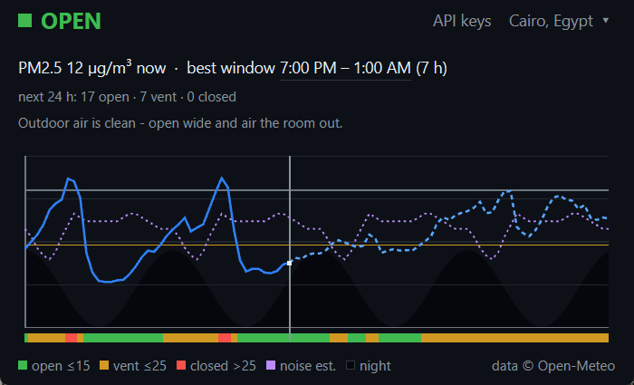

# AirQlality

[](https://github.com/Magid-William/AirQlality/actions/workflows/ci.yml)
[](https://github.com/Magid-William/AirQlality/releases/latest)
[](LICENSE)

A small Windows widget that answers one question well: **is it safe to open the
window for fresh air, and when?**

It reads open air-quality data, turns it into a verdict and a timeline, and
lives in the notification area so it is one click away instead of one more tab.




## What it does

- **A verdict, not a dashboard** - `OPEN`, `VENT` or `KEEP CLOSED` for right
  now, with the reason spelled out in a sentence.
- **A timeline you can read** - 48 h of PM2.5 (solid past, dashed forecast),
  a min-max envelope when several sources disagree, a day/night wave, and a
  dotted noise estimate. Times read as `7:00 PM`; click the best window to
  switch the frame to 24-hour.
- **Next 24 h at a glance** - how many open, vent and closed hours are coming,
  and when the next clean stretch starts.
- **A best window**, clamped to the next 24 h instead of a single 19 h run
  across the whole series.
- **Searchable locations** - 34,152 cities baked in (GeoNames), Cairo first;
  the selection is remembered.
- **Tray icon, hide-instead-of-quit, opt-in startup** - the tray icon is tinted
  by the verdict; closing the window hides it, and "Run at startup" writes a
  per-user `HKCU\...\Run` entry (no admin rights).
- **One notification, and only when it matters** - a system balloon fires when
  the verdict *becomes* `KEEP CLOSED`, never for `OPEN`/`VENT`, and never twice
  for the same spell.
- **Refresh from the tray** when a fetch fails, instead of waiting for the next
  half-hour boundary.
- **Keyboard and screen-reader access** - Tab/Shift+Tab, Enter/Space, Ctrl+K,
  Ctrl+Q, a visible focus ring, and AccessKit roles.

## How it decides

PM2.5 in µg/m³ drives the verdict: **open** at or below 15, **vent** at or
below 25, **closed** above that. With several sources, the per-hour value is the
**median** and a band that straddles a threshold takes the more protective
verdict, labelled "sources disagree". Missing a key only removes a source; it
never changes the app's state.

## Download

[**Latest release**](https://github.com/Magid-William/AirQlality/releases/latest) -
`AirQlality-v<version>-windows-x64.zip`, for 64-bit Windows 10 (1903 or later) and
Windows 11. Unzip anywhere and run `airqlality.exe`: no installer, no runtime to
install, nothing written outside `%APPDATA%\AirQlality` (keys and the last chosen
location).

The download is not code-signed, so SmartScreen shows *"Windows protected your
PC"* on first run - **More info -> Run anyway**. Each release ships a
`SHA256SUMS.txt` next to the zip:

```powershell
Get-FileHash .\AirQlality-*.zip -Algorithm SHA256
```

Releases are built by the `Release` workflow from the tagged commit, after the
same test suites CI runs.

## Build & run

Rather build it yourself? Requirements: Windows, the Rust stable GNU toolchain
(`rust-toolchain.toml` pins `stable-x86_64-pc-windows-gnu`), and **MinGW-w64 on
`PATH`** (`gcc` and `windres` are used by `psm` and by the icon build step).

```powershell
cargo run -p airqlality            # debug
cargo run -p airqlality --release  # optimized, GUI subsystem (no console)
```

The binary lands at `target\release\airqlality.exe`.

Tests:

```powershell
cargo test -p airqlality-core        # pure logic: verdict, fusion, parsing, schedule
cargo test -p airqlality --bin airqlality
cargo test -p airqlality --test e2e_widget   # windowed: launches the real widget
```

The E2E suite spawns the real window and screenshots it, so it flashes windows
for a few minutes; run it deliberately.

## Data sources

Nothing is bundled except the city list; the app fetches the rest.

| Source | What it gives | Key |
|---|---|---|
| [Open-Meteo Air Quality](https://open-meteo.com/) (CAMS ENSEMBLE) | hourly PM2.5 forecast, 48 h | none |
| [OpenAQ](https://openaq.org/) | ground-station PM2.5 near the city | free key |
| [OpenWeatherMap Air Pollution](https://openweathermap.org/api/air-pollution) | a second model forecast | free key |

Keys are optional. Open the prompt from the tray menu's **API keys...** item, or
press `Ctrl+Shift+K`. It asks for one source at a time - OpenAQ, then
OpenWeatherMap - with **Prev / Next** to move between them; each step keeps what
you typed. The **free-key address is a link** that opens your browser. **Enter**
(or Save) stores only the current key and stays on that
step, **Esc** (or Cancel) closes, **Remove** turns that source off. Paste with
`Ctrl+V`; the field is masked, a too-short paste or the *other* source's key is
refused, and the key is checked right away (`key accepted`, or
`rejected: HTTP 401`). Saved keys apply immediately, without a restart. A
brand-new OpenWeatherMap key can take up to two hours to activate.

They live **outside** the repository, in `%APPDATA%\AirQlality\config.json`:

```json
{ "openaq_key": "...", "owm_key": "..." }
```

or in `AIRQLALITY_OPENAQ_KEY` / `AIRQLALITY_OWM_KEY` (they win over the file,
and the prompt says so when one is set). Without a key the source is simply
absent, and the footer credit names only the sources that actually produced
data.

Attribution and data licences are in [`NOTICE`](NOTICE) and
[`core/assets/ATTRIBUTION.md`](core/assets/ATTRIBUTION.md). The noise curve is
an estimate modelled from GRIP4 road density, not a measurement.

## Experiments

This repository is built experiment by experiment: each hypothesis gets a
branch, a `README.md` with its method and evidence, and a row in
[`experiments-overview.md`](experiments-overview.md). The log - including the
dead ends - is the most honest documentation of why the app looks the way it
does.

## Licence

Code: [MIT](LICENSE). Bundled geodata keeps its own licence (GeoNames CC BY 4.0,
the GRIP4 derivative under ODbL) - see [`NOTICE`](NOTICE).
